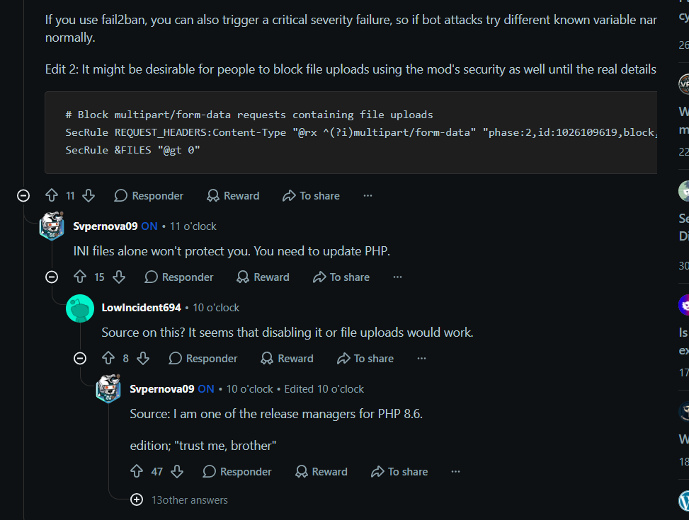

# php2shell

CVE-2026-109618 and CVE-2026-109619

A script to check whether a server's PHP is exposed to PHP2Shell, apply the temporary mitigations, and confirm the patch once it's installed.

**The patch is out** (released 21 Oct 2026, 13:36 UTC). Fixed versions: **8.2.35, 8.3.36, 8.4.27, 8.5.12**. Updating PHP is the only complete fix — the mitigations below only shrink the attack surface until you can patch.

## Quick start

```sh
# 1. get the script
curl -fsSLO https://raw.githubusercontent.com/5kr1pt/fix-to-php2shell/main/php2shell.sh

# 2. diagnose (read-only, changes nothing). It prints the exact update command for your distro.
sh php2shell.sh check

# 3. update PHP to 8.2.35 / 8.3.36 / 8.4.27 / 8.5.12 (run the command step 2 printed)

# 4. confirm the update took — must end with RESULTADO: CORRIGIDO
sh php2shell.sh check
```

Two `check` runs on purpose: step 2 tells you if you're exposed, step 4 verifies the patch landed.

If you genuinely can't patch this minute, apply a stopgap (`block` is the broader one, see below), then patch as soon as you can.

## Commands

| Command | What it does | Root? |
|---|---|---|
| `check` | Lists every PHP serving web traffic (php-fpm, mod_php, `php -S`) with version, patch status, mitigation status, and whether it's running and reachable on the network. **Changes nothing.** | no |
| `fix` | Writes the ini mitigation (`session.upload_progress.enabled = 0`, plus `fatal_error_backtraces = 0` for 8.5) to every PHP `conf.d`, tests the config and reloads php-fpm and Apache. **Partial — see below.** | yes |
| `undo` | Removes what `fix` created and reloads. | yes |
| `block` | **Broader stopgap.** Blocks multipart POST requests at Apache/nginx. Covers the entry vector for *both* CVEs but **breaks file uploads** unless you allowlist paths. | yes |
| `unblock` | Removes the multipart block. | yes |
| `harden` | **Opt-in, for CVE-2026-109618 (OOM).** Sets `memory_limit=-1` + `post_max_size` via `php_admin_value` (FPM pool / Apache). Higher risk — see below. | yes |
| `unharden` | Removes the harden config. | yes |
| `docker <cmd> [container...]` | Runs any of the above inside running containers (docker or podman). No names = every running container with PHP. | — |

Exit codes, from lowest to highest risk: `0` patched · `1` vulnerable but stopped or localhost only · `2` vulnerable, mitigated · `3` vulnerable and exposed · `4` error. The last line is always `RESULTADO: <status>`.

> **Important:** none of these commands *fix* the bug. One of the PHP 8.6 release managers said on r/PHP that the ini change alone won't protect you and that you need to update PHP. The official advisories say the same: updating is "the only reliable mitigation".
>
> 
>
> Thread: https://www.reddit.com/r/PHP/comments/1xb2utu/upcoming_critical_php_security_release/

## The two bugs (from the official advisories)

Both are **unauthenticated memory-corruption RCEs** in PHP core (CWE-416, use-after-free), reached while PHP parses a `multipart/form-data` request **before any application code runs** — so every PHP app is in scope regardless of framework. This is **not** application deserialization.

- **CVE-2026-109618 — OOM corruption** ([GHSA-w8hw-w9fx-j79w](https://github.com/php/php-src/security/advisories/GHSA-w8hw-w9fx-j79w)): PHP uses `longjmp()` to bail out on out-of-memory. At certain points request memory is reachable before it's fully initialised; if an allocation fails there, request shutdown reads memory in an invalid state. Triggered by multipart OOM (parts without a usable content-length, unlimited headers per part, empty file controls with nested names). **mod_php is the confirmed vector.** It does **not** need `session.upload_progress`.
- **CVE-2026-109619 — stale global state** ([GHSA-6wmf-4rv5-p3rp](https://github.com/php/php-src/security/advisories/GHSA-6wmf-4rv5-p3rp)): worker globals (error, session, object state) keep pointing at memory owned by a request that's already gone. A fatal error (including OOM) interrupts an operation before its reset runs; a later request on the same worker uses the stale state. Confirmed producers: `fatal_error_backtraces` on 8.5, and the session **upload-progress** path (enabled by default, no `session_start()` needed).

## `fix` — ini mitigation (partial)

`fix` writes `session.upload_progress.enabled = 0` and `fatal_error_backtraces = 0`. These are cheap (almost no app uses them, uploads keep working), and they are listed in the CVE-2026-109619 advisory as partial mitigations — they remove two confirmed paths for that bug. **They do nothing for CVE-2026-109618 (OOM), which needs neither feature.** So `fix` alone is not enough; for 109618 use `block` (entry vector) or `harden` (the advisory's ini mitigation), and patch as soon as you can.

```sh
sudo sh php2shell.sh fix      # apply
sudo sh php2shell.sh undo     # revert
```

## `block` — reject multipart POSTs (broader stopgap)

Both CVEs are reached through multipart request parsing, so rejecting `multipart/form-data` POSTs at the web server cuts the entry vector for both. But **it breaks every upload** unless you allowlist the paths that need them.

```sh
# block everything (no uploads anywhere):
sudo sh php2shell.sh block

# keep uploads working on specific paths:
sudo PHP2SHELL_UPLOAD_PATHS="/wp-admin /api/upload" sh php2shell.sh block

sudo sh php2shell.sh unblock   # revert
```

- **Apache** (Debian and RHEL families): the rule is written to the server's include dir, validated and reloaded automatically. It matches any `Content-Type` starting with `multipart/`, so it isn't fooled by the `;` vs `,` boundary trick.
- **Allowlist** paths match at a path boundary: `/wp-admin` allows `/wp-admin` and `/wp-admin/...`, but not `/wp-admin-anything`.
- **nginx**: the block isn't applied automatically (nginx can't do it globally and safely). The command prints a snippet to paste into each `server {}` block.

## `harden` — ini mitigation for CVE-2026-109618 (opt-in, higher risk)

The OOM advisory (GHSA-w8hw-w9fx-j79w) says to set `memory_limit=-1` so applications can't override it (via `php_admin_value` in the FPM pool / Apache config), plus a low `post_max_size`. `harden` does exactly that, writing one `php_admin_value` drop-in per FPM pool and for Apache mod_php, validating the config and rolling back automatically if php-fpm would refuse it.

```sh
sudo sh php2shell.sh harden                              # memory_limit=-1, post_max_size=8M
sudo PHP2SHELL_POST_MAX_SIZE=32M sh php2shell.sh harden   # if you need bigger uploads
sudo sh php2shell.sh unharden                            # revert
```

Read this before running it:

- It is **partial** — the advisory says an underlying allocation failure can still reach the vulnerable path. It does not replace the patch.
- `memory_limit=-1` means **one request can exhaust all RAM**. You **must** have a container/cgroup memory cap as a boundary first, or this becomes a DoS. `harden` warns if it can't see one. Do **not** use `RLIMIT_AS`/`RLIMIT_DATA` for the cap — the advisory says they reintroduce the bug.
- `post_max_size` (default `8M`) **breaks larger uploads**. Use `PHP2SHELL_POST_MAX_SIZE=32M` if you need them.
- This is why it's separate from `fix` and off by default. If you can, prefer `block` (cuts the entry vector with no DoS risk) or just patch.

## Docker and Kubernetes

`docker fix`/`docker block` are gone as soon as a container is recreated. The real fix is updating the base image once it carries 8.2.35 / 8.3.36 / 8.4.27 / 8.5.12, then rebuild and redeploy. For a stopgap that survives a recreate, bake the ini in:

```dockerfile
RUN { echo 'session.upload_progress.enabled = 0'; echo 'fatal_error_backtraces = 0'; } > "$PHP_INI_DIR/conf.d/zz-php2shell.ini"
```

On Kubernetes you can mount it from a ConfigMap without rebuilding:

```yaml
apiVersion: v1
kind: ConfigMap
metadata:
  name: php2shell-mitigation
data:
  zz-php2shell.ini: |
    session.upload_progress.enabled = 0
    fatal_error_backtraces = 0
```

```yaml
# in the PHP container of the Deployment
volumeMounts:
  - name: php2shell
    mountPath: /usr/local/etc/php/conf.d/zz-php2shell.ini
    subPath: zz-php2shell.ini
volumes:
  - name: php2shell
    configMap:
      name: php2shell-mitigation
```

Then run `kubectl rollout restart deploy/<app>`.

## Coverage

Works on Debian/Ubuntu, RHEL/Rocky/Alma, Alpine, the official `php:*` images, Remi, cPanel, Plesk and CloudLinux.

On Ubuntu the version doesn't change with the patch (it stays `8.3.6`), so the script looks for the CVE IDs in the package changelog. The network check only sees the host itself — if you removed external access at the proxy, firewall or DNS, the script can't tell, so it keeps the service as `EXPOSTO`. That's on purpose.

`check` also warns when:

- a pool forces `upload_progress = On`;
- the process is still running the old binary after an upgrade;
- the service is stopped but enabled at boot;
- php-fpm accepts FastCGI straight from the network (e.g. `0.0.0.0:9000`);
- the version is 8.1 or older, which won't get a PHP patch.

## Tests

Tested on Laravel 13 (`php:8.4-fpm` + nginx), WordPress (`wordpress:php8.3-apache`), Debian 13 with php-fpm, Ubuntu 24.04 with Apache + mod_php, Rocky 9 with httpd + php-fpm, Alpine (`php:8.3-fpm-alpine`) and Debian with systemd. `check` was also validated against a PHP 8.4.27 build from source (reports `CORRIGIDO`).

The test doesn't trust `ini_get()`. For `fix`, it sends a multipart POST with `PHP_SESSION_UPLOAD_PROGRESS` and checks whether PHP wrote the session file to disk — which happens before any application code, even on Laravel. For `block`, it confirms a multipart POST gets a 403, an allowlisted path still accepts uploads, and the rest of the site keeps working. For `harden`, it reads the effective `memory_limit` over FastCGI and checks it goes to `-1` and back. This verifies the mitigations are applied and the patch verdict is correct — it is not an exploit. Don't run the "PoCs" circulating on X and random sites; many carry malware.

```sh
tests/lab.sh up && tests/lab.sh test && tests/lab.sh down
```

## Timeline

- Two unauthenticated RCEs in PHP core, CVSS v4.0 9.2 each. Details leaked on 20 Oct, before the embargo ended.
- Cloudflare and Patchstack reported attacks from the morning of the 21st.
- 08:20 (local): Cloudflare says they're already seeing early attacks against the two leaked bugs. WAF rules are live for all plans, including free, but they call it a stopgap.


- 13:36 UTC, 21 Oct: PHP released 8.2.35 / 8.3.36 / 8.4.27 / 8.5.12 (earlier than the scheduled 14:00, due to active exploitation). 8.1 and older are EOL — no PHP patch, only distro backports.

## Links

- https://www.php.net/
- https://github.com/php/php-src/security/advisories/GHSA-w8hw-w9fx-j79w (CVE-2026-109618)
- https://github.com/php/php-src/security/advisories/GHSA-6wmf-4rv5-p3rp (CVE-2026-109619)
- https://sansec.io/research/php2shell
- https://www.huntress.com/blog/php2shell-leaked-critical-php-vulnerabilities
- https://www.tenable.com/blog/php2shell-cve-2026-109618-cve-2026-109619-frequently-asked-questions-about-critical-php-remote
